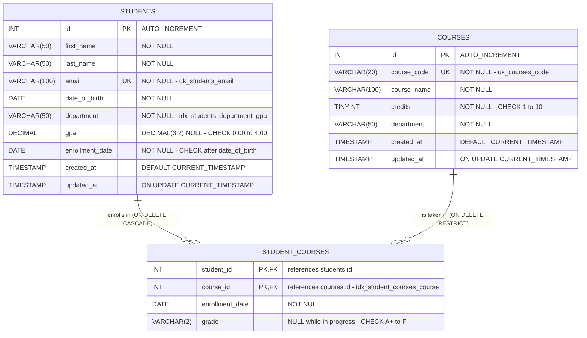
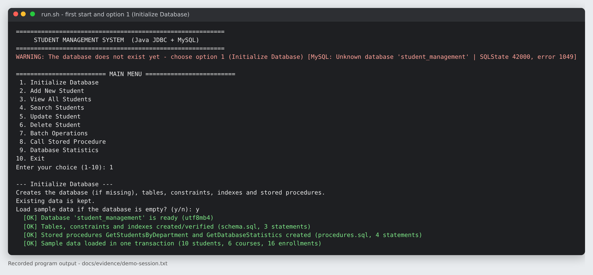
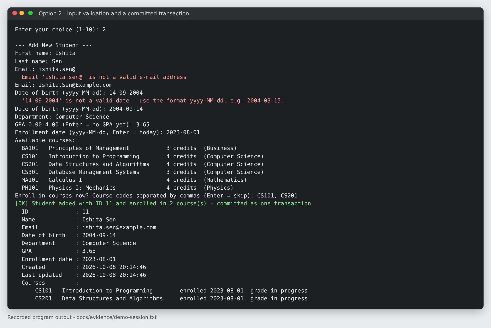
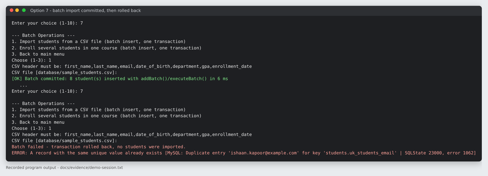
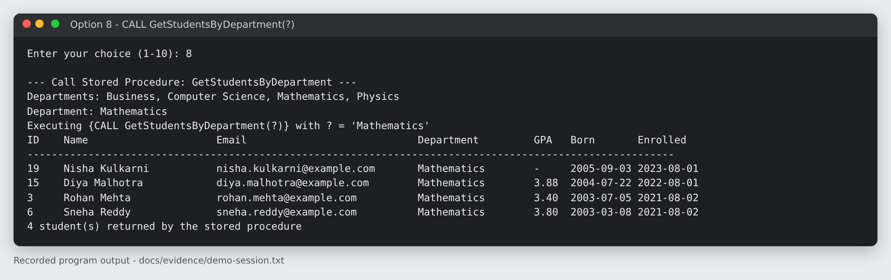
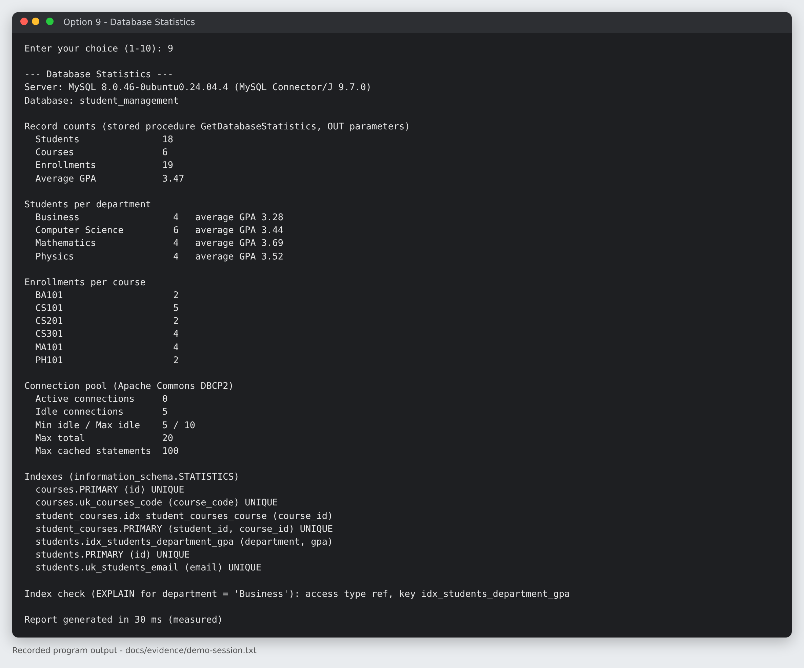
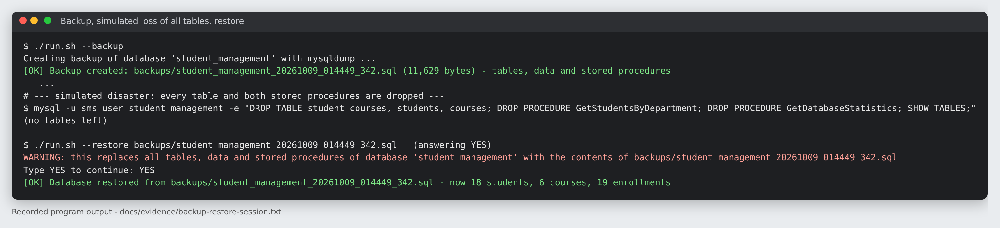

# Student Management System with MySQL using Java JDBC

A console application that manages students, courses and enrollments in a MySQL database using
plain **Java JDBC** - with a DBCP2 connection pool, DAOs built on `PreparedStatement`, real
transactions, JDBC batch operations, stored procedures called through `CallableStatement`, and
backup/recovery. 112 automated tests - most of them database integration tests against a real
MySQL server - verify every feature.

---

## Contents

1. [Project Title](#1-project-title)
2. [Project Overview](#2-project-overview)
3. [Objectives](#3-objectives)
4. [Features](#4-features)
5. [Technologies](#5-technologies)
6. [Requirements / Prerequisites](#6-requirements--prerequisites)
7. [Project Structure](#7-project-structure)
8. [MySQL Database Setup](#8-mysql-database-setup)
9. [JDBC Configuration](#9-jdbc-configuration)
10. [How to Run](#10-how-to-run)
11. [Database Initialization](#11-database-initialization)
12. [CRUD Operations](#12-crud-operations)
13. [Transaction Management](#13-transaction-management)
14. [Batch Operations](#14-batch-operations)
15. [Stored Procedure](#15-stored-procedure)
16. [Backup and Recovery](#16-backup-and-recovery)
17. [Testing](#17-testing)
18. [Screenshots / Output Examples](#18-screenshots--output-examples)
19. [Troubleshooting](#19-troubleshooting)
20. [Deployment / Setup Notes](#20-deployment--setup-notes)

Further documentation: [Database design & ER diagram](docs/DATABASE_DESIGN.md) ·
[JDBC & DAO architecture](docs/JDBC_ARCHITECTURE.md) · [Backup & recovery](docs/BACKUP_AND_RECOVERY.md) ·
[Performance](docs/PERFORMANCE.md) · [Deployment guide](docs/DEPLOYMENT_GUIDE.md) ·
[Testing & evidence](docs/TESTING.md) · [Requirements traceability](docs/REQUIREMENTS_TRACEABILITY.md)

---

## 1. Project Title

**Student Management System with MySQL using Java JDBC**

## 2. Project Overview

The application stores students, courses and the enrollment relationship between them in the
MySQL database `student_management` and offers a numbered console menu to initialise the
database, add, view, search, update and delete students, run batch operations, call a stored
procedure and show database statistics.

It is built in layers - `Main` (console) -> services (validation, transactions) -> DAOs (SQL) ->
a pooled `DataSource` -> MySQL - using only the JDK, the MySQL JDBC driver and Apache Commons
DBCP2. All database rules (keys, foreign keys, unique and CHECK constraints) are enforced by
MySQL itself and validated again in Java so users get clear messages.

## 3. Objectives

* Design a normalised MySQL schema with primary keys, foreign keys, unique, NOT NULL and CHECK
  constraints, timestamps and indexes.
* Access MySQL through a JDBC **connection pool** (Apache Commons DBCP2).
* Implement a **DAO for every entity** with CRUD operations using **PreparedStatement**.
* Apply **transaction management** (commit / rollback) and **batch processing**.
* Create **stored procedures** and call them with **CallableStatement**.
* Provide **backup and recovery** of the database.
* Provide reusable database utilities, complete SQL scripts, configuration, integration tests
  and documentation with real testing evidence.

## 4. Features

| Menu option | What it does |
|---|---|
| 1. Initialize Database | creates the database (if missing), tables, constraints, indexes and stored procedures from `database/*.sql`; optionally loads sample data into an empty database |
| 2. Add New Student | validated input; optionally enrolls the new student in courses - student and enrollments are saved in **one transaction** |
| 3. View All Students | table of all students |
| 4. Search Students | by ID (with enrolled courses) or by any combination of name/e-mail text, department and minimum GPA |
| 5. Update Student | shows current values; Enter keeps a value |
| 6. Delete Student | with confirmation; enrollments are removed by `ON DELETE CASCADE` |
| 7. Batch Operations | CSV import of students and enrollment of several students in a course - JDBC batches, all-or-nothing |
| 8. Call Stored Procedure | `GetStudentsByDepartment` through `CallableStatement` |
| 9. Database Statistics | counts from the stored procedure `GetDatabaseStatistics` (OUT parameters), per-department / per-course figures, connection-pool status, index list and an EXPLAIN check |
| 10. Exit | closes the connection pool |

Additionally:

* `--backup` / `--restore <file>` command-line options (mysqldump / mysql) - see section 16;
* input validation with immediate feedback (required fields, e-mail, date format, numbers, menu choice);
* friendly error messages for MySQL errors with the technical details, stack traces in
  `logs/application.log`;
* credentials from environment variables, SQL-injection-safe dynamic search.

## 5. Technologies

| Technology | Version used / tested | Role |
|---|---|---|
| Java (JDK) | JDK 17+ recommended; code compiled with `--release 11`; tested on OpenJDK 17 and 21 (application also on 11) | application language |
| MySQL Server | 8.0.16+ required, tested on 8.0.46 | database (InnoDB) |
| JDBC (`java.sql`, `javax.sql`) | JDBC 4.2 | database access |
| MySQL Connector/J | 9.7.0 (`lib/`) | JDBC driver |
| Apache Commons DBCP2 | 2.10.0 (+ Commons Pool2 2.11.1, Commons Logging 1.3.0) | connection pool |
| SQL | MySQL dialect | schema, procedures, data |
| JUnit 5 | 5.10.1 (console launcher, `lib/test/`) | tests only |

No Spring, Hibernate/JPA, Lombok, web framework or build tool is used. See
[`lib/README.md`](lib/README.md) for the libraries and their origin.

## 6. Requirements / Prerequisites

* **JDK 17 or newer** recommended (`javac -version`); the full test suite was run on JDK 17 and 21.
  The application itself targets Java 11 and also runs on JDK 11, but the bundled JUnit runner
  needs Java 12+ (see [`lib/README.md`](lib/README.md)).
* **MySQL Server 8.0.16 or newer**, running (CHECK constraints are enforced from 8.0.16).
* A MySQL account that may create the database - `root`, or the dedicated account created by
  `database/create_app_user.sql`.
* For backup/restore only: the MySQL client tools **`mysqldump`** and **`mysql`** (installed with
  MySQL Server).
* Windows, macOS or Linux. No internet access and no build tool are needed.

## 7. Project Structure

```
StudentManagementSystem/
├── src/com/studentmanagement/
│   ├── config/
│   │   ├── DatabaseConfig.java        DBCP2 pool + configuration loading
│   │   └── DatabaseInitializer.java   creates database, tables, procedures, sample data (option 1)
│   ├── model/
│   │   ├── Student.java               POJOs: private fields, constructors,
│   │   ├── Course.java                getters/setters, toString()
│   │   └── Enrollment.java
│   ├── dao/
│   │   ├── StudentDAO.java            CRUD, search, batch insert, stored procedure call
│   │   ├── CourseDAO.java             CRUD
│   │   └── EnrollmentDAO.java         CRUD + batch insert inside a transaction
│   ├── service/
│   │   ├── StudentService.java        validation, transactions, CSV import, batch enrollment
│   │   └── ReportService.java         statistics (option 9), GetDatabaseStatistics call
│   ├── util/
│   │   ├── DatabaseUtils.java         transaction template, error messages, SQL scripts, backup/restore
│   │   └── QueryBuilder.java          parameterised dynamic SELECT for the search
│   └── Main.java                      console menu, --backup / --restore
├── tests/com/studentmanagement/       JUnit 5 tests (12 test classes + TestDatabase helper, 112 tests)
├── database/
│   ├── schema.sql                     tables, constraints, indexes
│   ├── procedures.sql                 GetStudentsByDepartment, GetDatabaseStatistics
│   ├── seed.sql                       sample data
│   ├── install.sql                    one-step install with the mysql client
│   ├── create_app_user.sql            optional least-privilege account
│   └── sample_students.csv            input for the batch import
├── config/
│   ├── database.properties            application configuration
│   └── database-test.properties       test configuration (student_management_test)
├── lib/                               JDBC driver, DBCP2 + dependencies; lib/test/: JUnit
├── docs/                              design, architecture, backup, performance, deployment,
│   ├── images/                        testing, traceability; ER / architecture / flow diagrams
│   ├── screenshots/                   images of real console output
│   └── evidence/                      captured output of real runs
├── run.sh / run.bat                   compile + start (also --backup / --restore)
├── run-tests.sh / run-tests.bat       compile + run all tests
└── README.md
```

Generated at run time (not part of the source): `out/` (compiled classes, test reports),
`logs/application.log`, `backups/`.

## 8. MySQL Database Setup

1. Start MySQL and make sure you can log in, e.g. `mysql -u root -p`.
2. Choose the account the application will use:
   * `root` - nothing to prepare, or
   * recommended: edit the password in `database/create_app_user.sql` and run
     `mysql -u root -p < database/create_app_user.sql` (creates `sms_user` with rights only on
     `student_management` and `student_management_test`).
3. Create the database objects - either
   * **from the application:** start it and choose **option 1** (see section 11), or
   * **with the mysql client** (from the project root): `mysql -u root -p < database/install.sql`.

The schema in short ([details and ER diagram](docs/DATABASE_DESIGN.md)):



| Table | Key columns | Constraints |
|---|---|---|
| `students` | `id` PK AUTO_INCREMENT | `email` UNIQUE, GPA CHECK 0.00-4.00, enrollment after birth, `created_at` / `updated_at` timestamps |
| `courses` | `id` PK AUTO_INCREMENT | `course_code` UNIQUE, credits CHECK 1-10 |
| `student_courses` | (`student_id`, `course_id`) PK | FK to students `ON DELETE CASCADE`, FK to courses `ON DELETE RESTRICT`, grade CHECK |

Indexes: `idx_students_department_gpa (department, gpa)` and `idx_student_courses_course (course_id)`
in addition to the primary-key and unique indexes - each justified by a query
(see [PERFORMANCE.md](docs/PERFORMANCE.md#3-indexes)).

## 9. JDBC Configuration

`config/database.properties`:

| Property | Default | Meaning |
|---|---|---|
| `db.url` | `jdbc:mysql://localhost:3306/student_management?rewriteBatchedStatements=true` | JDBC URL; the database name in the URL is the one used |
| `db.username` | `root` | overridden by the `DB_USERNAME` environment variable |
| `db.password` | *(empty)* | overridden by the `DB_PASSWORD` environment variable - preferred, so no password is stored in a file |
| `pool.initialSize` | 5 | connections opened when the pool starts |
| `pool.minIdle` | 5 | minimum idle connections kept ready |
| `pool.maxIdle` | 10 | maximum idle connections |
| `pool.maxTotal` | 20 | maximum connections (active + idle) |
| `pool.maxWaitMillis` | 10000 | wait time for a free connection before an error |
| `pool.maxOpenPreparedStatements` | 100 | PreparedStatement cache size (`poolPreparedStatements=true`) |
| `pool.timeBetweenEvictionRunsMillis` | 30000 | evictor interval (keeps `minIdle` filled, removes broken connections) |
| `app.sqlScriptsDir` | `database` | location of the SQL scripts |
| `backup.directory` | `backups` | where backups are written |
| `backup.mysqldumpPath` / `backup.mysqlPath` | `mysqldump` / `mysql` | client tools for backup/restore (full path if not on the PATH) |

The pool is created in `DatabaseConfig` (Apache Commons DBCP2 `BasicDataSource`):

```java
pool.setDriverClassName("com.mysql.cj.jdbc.Driver");
pool.setUrl(getUrl());
pool.setUsername(getUsername());
pool.setPassword(getPassword());
pool.setInitialSize(5);
pool.setMinIdle(5);
pool.setMaxIdle(10);
pool.setMaxTotal(20);
pool.setPoolPreparedStatements(true);
pool.setMaxOpenPreparedStatements(100);
```

`rewriteBatchedStatements=true` lets the driver send JDBC batches as multi-row INSERTs. Tests use
`config/database-test.properties` (database `student_management_test`), selected with
`-Ddb.config=...`.

## 10. How to Run

Open a terminal **in the project root** and provide the credentials:

```bash
export DB_USERNAME=root            # Windows: set DB_USERNAME=root
export DB_PASSWORD='your-password' # Windows: set DB_PASSWORD=your-password
```

Start the application:

```bash
./run.sh          # Linux / macOS
run.bat           # Windows
```

The script compiles `src/` with `javac --release 11` into `out/classes` and runs
`com.studentmanagement.Main` with `lib/*` on the classpath. Equivalent manual commands:

```bash
javac --release 11 -d out/classes -cp "lib/*" $(find src -name "*.java")
java -cp "out/classes:lib/*" com.studentmanagement.Main          # Windows: "out\classes;lib\*"
```

On first start the program reports that the database does not exist yet - choose **1**.
To run from an IDE see [DEPLOYMENT_GUIDE.md](docs/DEPLOYMENT_GUIDE.md#8-running-from-an-ide-optional).

## 11. Database Initialization

Menu option **1** (`DatabaseInitializer`):

1. `CREATE DATABASE IF NOT EXISTS student_management CHARACTER SET utf8mb4 COLLATE utf8mb4_unicode_ci`
   (one short non-pooled connection, because the pool's URL points to this database);
2. runs `database/schema.sql` - 3 tables with constraints and indexes (`CREATE TABLE IF NOT EXISTS`);
3. runs `database/procedures.sql` - drops and recreates the 2 stored procedures; the built-in
   script runner understands `DELIMITER` lines like the mysql client;
4. if you answer `y` **and** all tables are empty: runs `database/seed.sql` in one transaction
   (10 students, 6 courses, 16 enrollments).

It never deletes data and can be run any number of times.

## 12. CRUD Operations

| Operation | Menu | DAO method | SQL (all parameters bound with `?`) |
|---|---|---|---|
| Create | 2 | `StudentDAO.addStudent` | `INSERT INTO students (...) VALUES (?, ?, ?, ?, ?, ?, ?)` + generated key |
| Read one | 4 -> 1 | `StudentDAO.getStudentById` | `SELECT ... FROM students WHERE id = ?` |
| Read all | 3 | `StudentDAO.getAllStudents` | `SELECT ... FROM students ORDER BY id` |
| Search | 4 -> 2 | `StudentDAO.searchStudents` | built by `QueryBuilder`, e.g. `... WHERE (first_name LIKE ? OR ...) AND (department = ?) AND (gpa >= ?)` |
| Update | 5 | `StudentDAO.updateStudent` | `UPDATE students SET ... WHERE id = ?` |
| Delete | 6 | `StudentDAO.deleteStudent` | `DELETE FROM students WHERE id = ?` |

`CourseDAO` and `EnrollmentDAO` provide the same complete CRUD set for courses and enrollments.
Every method uses try-with-resources so `Connection`, `PreparedStatement` and `ResultSet` are
always closed and the connection goes back to the pool. Example:

```java
public boolean deleteStudent(int id) throws SQLException {
    try (Connection connection = dataSource.getConnection();
         PreparedStatement statement = connection.prepareStatement("DELETE FROM students WHERE id = ?")) {
        statement.setInt(1, id);
        return statement.executeUpdate() == 1;
    }
}
```

User input is never concatenated into SQL; the search escapes `%` and `_`, and a test proves that
inputs such as `' OR '1'='1` or `x'; DROP TABLE students; --` are treated as plain text.

## 13. Transaction Management

`DatabaseUtils.executeInTransaction` runs a unit of work on one pooled connection:
`setAutoCommit(false)` -> work -> `commit()`; on **any** `SQLException` or `RuntimeException` ->
`rollback()` and rethrow; finally auto-commit is restored and the connection is returned to the pool.

```java
int id = DatabaseUtils.executeInTransaction(dataSource, connection -> {
    int studentId = studentDAO.addStudent(connection, student);              // 1. INSERT student
    List<Enrollment> enrollments = new ArrayList<>();
    for (String code : codes) {                                              // 2. resolve courses
        Course course = courseDAO.getCourseByCode(connection, code)
                .orElseThrow(() -> new IllegalArgumentException("Unknown course code: " + code));
        enrollments.add(new Enrollment(studentId, course.getId(), student.getEnrollmentDate(), null));
    }
    enrollmentDAO.addEnrollmentsBatch(connection, enrollments);              // 3. batch INSERT
    return studentId;
});
```
*(simplified from `StudentService.registerStudentWithCourses`)*

Used for: adding a student together with course enrollments (option 2), the CSV batch import and
the batch enrollment (option 7), and loading the sample data (option 1). Rollback is proven by
tests - e.g. after a rolled-back registration the next student gets id 2, because the INSERT really
executed and InnoDB does not reuse the consumed AUTO_INCREMENT value. Details and the sequence
diagram: [JDBC_ARCHITECTURE.md](docs/JDBC_ARCHITECTURE.md#5-transaction-management).

## 14. Batch Operations

Option **7**:

1. **Import students from a CSV file** (default `database/sample_students.csv`, header
   `first_name,last_name,email,date_of_birth,department,gpa,enrollment_date`). Every row is
   validated first (errors are reported with line numbers and nothing is written); then all rows
   are inserted with `addBatch()` / `executeBatch()` in chunks of 500 inside one transaction.
2. **Enroll several students in one course** - one batch, one transaction.

If any row fails (e.g. duplicate e-mail, unknown student id), the whole batch is rolled back.
Measured on the test machine with `BatchPerformanceTest` (1,000 inserts):

```
[measurement] 1000 inserts: row-by-row 1138 ms, JDBC batch 47 ms
```

See [PERFORMANCE.md](docs/PERFORMANCE.md#4-batch-processing) for why and how this was measured.

## 15. Stored Procedure

`database/procedures.sql` defines two procedures, both used by the application:

```sql
CREATE PROCEDURE GetStudentsByDepartment(IN p_department VARCHAR(50))
    READS SQL DATA
BEGIN
    SELECT id, first_name, last_name, email, date_of_birth, department, gpa,
           enrollment_date, created_at, updated_at
    FROM students
    WHERE department = p_department
    ORDER BY last_name, first_name;
END
```

Called in `StudentDAO.getStudentsByDepartment` (menu option 8):

```java
try (Connection connection = dataSource.getConnection();
     CallableStatement statement = connection.prepareCall("{CALL GetStudentsByDepartment(?)}")) {
    statement.setString(1, department);
    try (ResultSet rs = statement.executeQuery()) {
        return mapRows(rs);
    }
}
```

`GetDatabaseStatistics(OUT p_total_students, OUT p_total_courses, OUT p_total_enrollments,
OUT p_average_gpa)` is called by `ReportService.getDatabaseTotals` with `registerOutParameter`
(menu option 9). Explanation: [DATABASE_DESIGN.md](docs/DATABASE_DESIGN.md#6-stored-procedures).

## 16. Backup and Recovery

```bash
./run.sh --backup                                   # Windows: run.bat --backup
./run.sh --restore backups/<file>.sql               # asks you to type YES
./run.sh --restore                                  # lists available backups
```

* **How:** `mysqldump --single-transaction --routines --triggers --no-tablespaces --databases student_management`
  - a consistent snapshot without locking, including table definitions, data and stored procedures.
* **Where:** `backups/student_management_<yyyyMMdd_HHmmss_SSS>.sql` (configurable).
* **Recovery:** the `mysql` client replays the file; the database is recreated if necessary and the
  tables, data and procedures are replaced. The restore then reads the record counts through
  the restored procedure to confirm success.
* **Security:** credentials are passed in a temporary owner-only option file, never on the command line.
* **Prerequisites:** `mysqldump` / `mysql` on the PATH or configured with `backup.mysqldumpPath` /
  `backup.mysqlPath`.

The full procedure, a recorded disaster-recovery run (all tables and procedures dropped, then
restored) and troubleshooting are in [BACKUP_AND_RECOVERY.md](docs/BACKUP_AND_RECOVERY.md).

## 17. Testing

```bash
./run-tests.sh          # Windows: run-tests.bat
```

The tests run against the separate database **`student_management_test`** (created automatically;
the test helper refuses to run against any database whose name does not end with `_test`).
Result of the recorded run ([`docs/evidence/test-run.txt`](docs/evidence/test-run.txt)):

```
[        15 containers found      ]
[       112 tests found           ]
[       112 tests successful      ]
[         0 tests failed          ]
```

| Area | Test classes |
|---|---|
| Connection pool | `DatabaseConfigTest` |
| Schema, procedures, sample data | `DatabaseInitializerTest` |
| CRUD, search, SQL injection, constraints, batches, stored procedure | `StudentDAOTest`, `CourseDAOTest`, `EnrollmentDAOTest`, `BatchPerformanceTest` |
| Validation, transaction commit/rollback, CSV import, batch enrollment | `StudentServiceTest` |
| Statistics, OUT parameters, EXPLAIN / index usage | `ReportServiceTest` |
| Query builder, script parser, transaction template, error messages | `QueryBuilderTest`, `DatabaseUtilsTest` |
| Backup -> total loss -> restore | `BackupRecoveryTest` |
| All 10 menu options end-to-end, invalid input, error messages | `MainMenuTest` |

Full inventory, requirement coverage and evidence files: [TESTING.md](docs/TESTING.md).

## 18. Screenshots / Output Examples

All examples are copied from the recorded session
[`docs/evidence/demo-session.txt`](docs/evidence/demo-session.txt) (unedited program output;
typed input is echoed after each prompt). Images of the same output are in
[`docs/screenshots/`](docs/screenshots/).

**Start on a server without the database, then option 1**



```
==========================================================
     STUDENT MANAGEMENT SYSTEM  (Java JDBC + MySQL)
==========================================================
WARNING: The database does not exist yet - choose option 1 (Initialize Database) [MySQL: Unknown database 'student_management' | SQLState 42000, error 1049]

========================= MAIN MENU =========================
 1. Initialize Database
 2. Add New Student
 3. View All Students
 4. Search Students
 5. Update Student
 6. Delete Student
 7. Batch Operations
 8. Call Stored Procedure
 9. Database Statistics
10. Exit
Enter your choice (1-10): 1

--- Initialize Database ---
Creates the database (if missing), tables, constraints, indexes and stored procedures.
Existing data is kept.
Load sample data if the database is empty? (y/n): y
  [OK] Database 'student_management' is ready (utf8mb4)
  [OK] Tables, constraints and indexes created/verified (schema.sql, 3 statements)
  [OK] Stored procedures GetStudentsByDepartment and GetDatabaseStatistics created (procedures.sql, 4 statements)
  [OK] Sample data loaded in one transaction (10 students, 6 courses, 16 enrollments)
```

**Option 2 - validation and a committed transaction**



```
--- Add New Student ---
First name: Ishita
Last name: Sen
Email: ishita.sen@
  Email 'ishita.sen@' is not a valid e-mail address
Email: Ishita.Sen@Example.com
Date of birth (yyyy-MM-dd): 14-09-2004
  '14-09-2004' is not a valid date - use the format yyyy-MM-dd, e.g. 2004-03-15.
Date of birth (yyyy-MM-dd): 2004-09-14
Department: Computer Science
GPA 0.00-4.00 (Enter = no GPA yet): 3.65
Enrollment date (yyyy-MM-dd, Enter = today): 2023-08-01
...
Enroll in courses now? Course codes separated by commas (Enter = skip): CS101, CS201
[OK] Student added with ID 11 and enrolled in 2 course(s) - committed as one transaction
```

**Option 2 - unknown course: the whole transaction is rolled back; duplicate e-mail**

```
Enroll in courses now? Course codes separated by commas (Enter = skip): PH101, XX999
Transaction rolled back - the student was NOT saved.
Validation error: Unknown course code: XX999
...
ERROR: A record with the same unique value already exists [MySQL: Duplicate entry 'aarav.sharma@example.com' for key 'students.uk_students_email' | SQLState 23000, error 1062]
```

**Option 7 - batch import committed, then the same file again (rolled back)**



```
CSV file [database/sample_students.csv]:
[OK] Batch committed: 8 student(s) inserted with addBatch()/executeBatch() in 6 ms
...
CSV file [database/sample_students.csv]:
Batch failed - transaction rolled back, no students were imported.
ERROR: A record with the same unique value already exists [MySQL: Duplicate entry 'ishaan.kapoor@example.com' for key 'students.uk_students_email' | SQLState 23000, error 1062]
```

**Option 8 - stored procedure**



```
--- Call Stored Procedure: GetStudentsByDepartment ---
Departments: Business, Computer Science, Mathematics, Physics
Department: Mathematics
Executing {CALL GetStudentsByDepartment(?)} with ? = 'Mathematics'
ID    Name                     Email                            Department         GPA   Born       Enrolled
----------------------------------------------------------------------------------------------------------
19    Nisha Kulkarni           nisha.kulkarni@example.com       Mathematics        -     2005-09-03 2023-08-01
15    Diya Malhotra            diya.malhotra@example.com        Mathematics        3.88  2004-07-22 2022-08-01
3     Rohan Mehta              rohan.mehta@example.com          Mathematics        3.40  2003-07-05 2021-08-02
6     Sneha Reddy              sneha.reddy@example.com          Mathematics        3.80  2003-03-08 2021-08-02
4 student(s) returned by the stored procedure
```

**Option 9 - database statistics**



```
--- Database Statistics ---
Server: MySQL 8.0.46-0ubuntu0.24.04.4 (MySQL Connector/J 9.7.0)
Database: student_management

Record counts (stored procedure GetDatabaseStatistics, OUT parameters)
  Students               18
  Courses                6
  Enrollments            19
  Average GPA            3.47

Students per department
  Business                 4   average GPA 3.28
  Computer Science         6   average GPA 3.44
  Mathematics              4   average GPA 3.69
  Physics                  4   average GPA 3.52
...
Connection pool (Apache Commons DBCP2)
  Active connections     0
  Idle connections       5
  Min idle / Max idle    5 / 10
  Max total              20
  Max cached statements  100
...
Index check (EXPLAIN for department = 'Business'): access type ref, key idx_students_department_gpa

Report generated in 30 ms (measured)
```

**Backup and recovery** ([full transcript](docs/evidence/backup-restore-session.txt))



```
$ ./run.sh --backup
Creating backup of database 'student_management' with mysqldump ...
[OK] Backup created: backups/student_management_20261009_014449_342.sql (11,629 bytes) - tables, data and stored procedures
...
$ ./run.sh --restore backups/student_management_20261009_014449_342.sql   (answering YES)
WARNING: this replaces all tables, data and stored procedures of database 'student_management' with the contents of backups/student_management_20261009_014449_342.sql
Type YES to continue: YES
[OK] Database restored from backups/student_management_20261009_014449_342.sql - now 18 students, 6 courses, 19 enrollments
```

## 19. Troubleshooting

| Message | Cause | Fix |
|---|---|---|
| `Configuration error: Database configuration file not found ...` | started from another folder | run from the project root (the scripts do this) |
| `Access denied - check db.username and the password (DB_PASSWORD) ... error 1045` | wrong user or password | set `DB_USERNAME` / `DB_PASSWORD` or edit `config/database.properties`; on Ubuntu `root` uses socket authentication - create `sms_user` (section 8) |
| `Cannot connect to MySQL - check that the server is running ... SQLState 08S01` | server stopped, wrong host/port | start MySQL; check `db.url` |
| `The database does not exist yet - choose option 1 ... error 1049` | first start | choose option 1 |
| `A table is missing` (1146) / `A stored procedure is missing` (1305) | schema not created | choose option 1 |
| `The MySQL account lacks a required privilege` (1044/1142/1370) | restricted account | grant privileges on the schema (`database/create_app_user.sql`) |
| `Public Key Retrieval is not allowed` | `caching_sha2_password` account on a server without TLS | enable TLS on the server, or for a local development server only add `&allowPublicKeyRetrieval=true` to `db.url` |
| CHECK constraints seem ignored | MySQL older than 8.0.16 | upgrade MySQL (the Java validation still applies) |
| `Cannot run 'mysqldump' ...` | client tools not on the PATH (typical on Windows) | set `backup.mysqldumpPath` / `backup.mysqlPath` to the full `.exe` paths |
| `Refusing to run destructive tests against database ...` | tests started without the test configuration | use `run-tests.sh` / `run-tests.bat` (adds `-Ddb.config=config/database-test.properties`) |
| `javac: command not found` / `invalid flag: --release` | no JDK or JDK 8 | install JDK 17+ and put it on the PATH |
| `UnsupportedClassVersionError ... opentest4j ... class file version 56.0` when running the tests | tests started with JDK 11 | run the tests with JDK 17+ (or replace the JUnit jar with the official one, see `lib/README.md`) |

Technical details of every error (stack traces) are in `logs/application.log`.

## 20. Deployment / Setup Notes

* **Step-by-step guide** for Windows, macOS and Linux (installation, account, configuration, IDE
  setup, verification, reset): [DEPLOYMENT_GUIDE.md](docs/DEPLOYMENT_GUIDE.md).
* **Credentials:** use a dedicated account with rights only on the application schema
  (`database/create_app_user.sql`) and pass the password via `DB_PASSWORD`; never store real
  passwords in the repository.
* **Remote servers:** add `sslMode=REQUIRED` to `db.url` to encrypt the connection.
* **Pool sizing:** keep `minIdle <= maxIdle <= maxTotal` (checked at start-up) and size
  `maxTotal` below MySQL's `max_connections`.
* **Backups:** schedule `run.sh --backup` (cron / Task Scheduler) and copy the files to another
  machine; test restores regularly.
* **Logs:** `logs/application.log`; the console shows only user-facing messages.
* **Tested environment:** Ubuntu 24.04, MySQL 8.0.46, OpenJDK 21 (all evidence) and OpenJDK 17
  (full test suite again); the application was also started on OpenJDK 11. The Windows scripts
  (`run.bat`, `run-tests.bat`) perform the same steps as the shell scripts.
