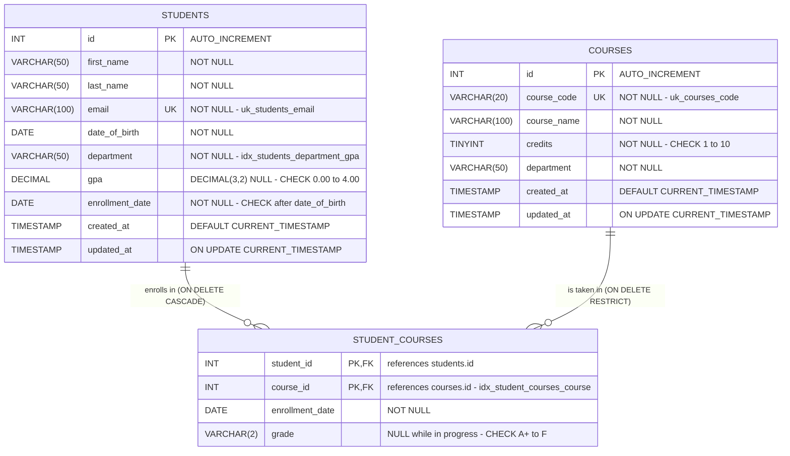

# Database Design

Database: **`student_management`** (MySQL 8.0.16+, InnoDB, `utf8mb4` / `utf8mb4_unicode_ci`)

Scripts: [`database/schema.sql`](../database/schema.sql) · [`database/procedures.sql`](../database/procedures.sql) ·
[`database/seed.sql`](../database/seed.sql) · [`database/install.sql`](../database/install.sql) ·
[`database/create_app_user.sql`](../database/create_app_user.sql)

---

## 1. Database architecture

| Aspect | Decision | Reason |
|---|---|---|
| Storage engine | **InnoDB** (declared on every table) | Required for transactions (commit/rollback) and foreign keys |
| Character set | **utf8mb4**, collation `utf8mb4_unicode_ci` (set on the database) | Full Unicode names; case-insensitive comparisons, so `Aarav@x.com` and `aarav@x.com` count as the same e-mail |
| Collation inheritance | Tables do not override the database collation | Table columns and stored-procedure parameters then always share one collation (no "Illegal mix of collations" when calling procedures) |
| Normal form | 3NF | Students and courses are independent entities; the many-to-many enrollment relationship has its own table |
| Integrity | Enforced **in the database** (PK, FK, UNIQUE, NOT NULL, CHECK) **and** validated in Java | The database is the last line of defence; Java gives friendly messages before any SQL runs |
| Separate test database | `student_management_test` | Automated tests never touch application data |

The application creates the database itself (menu option 1, `DatabaseInitializer`), or it can be
installed with the mysql client (`mysql -u root -p < database/install.sql`).

---

## 2. Entity-relationship diagram


The same diagram as Mermaid source (rendered automatically on GitHub):



Plain-text view:

```
 +------------------+          +---------------------+          +------------------+
 | students         |          | student_courses     |          | courses          |
 +------------------+ 1      * +---------------------+ *      1 +------------------+
 | PK id            |----------| PK,FK student_id    |----------| PK id            |
 |    first_name    |  CASCADE | PK,FK course_id     | RESTRICT |    course_code UK|
 |    last_name     |          |    enrollment_date  |          |    course_name   |
 | UK email         |          |    grade (nullable) |          |    credits       |
 |    date_of_birth |          +---------------------+          |    department    |
 |    department    |                                           |    created_at    |
 |    gpa (nullable)|                                           |    updated_at    |
 |    enrollment_date                                           +------------------+
 |    created_at    |
 |    updated_at    |
 +------------------+
```

---

## 3. Table relationships

| Relationship | Cardinality | Implemented by | On delete |
|---|---|---|---|
| students - courses | many-to-many | junction table `student_courses` | - |
| students -> student_courses | one-to-many | `fk_student_courses_student (student_id) REFERENCES students(id)` | **CASCADE** - deleting a student removes their enrollments (an enrollment cannot exist without its student) |
| courses -> student_courses | one-to-many | `fk_student_courses_course (course_id) REFERENCES courses(id)` | **RESTRICT** - a course that still has students cannot be deleted (protects enrollment history) |

Both behaviours are verified by tests (`EnrollmentDAOTest.deletingAStudentDeletesTheirEnrollments`,
`CourseDAOTest.aCourseWithEnrolledStudentsCannotBeDeleted`) and shown in the demo session
("Student 11 deleted (2 enrollment(s) removed by ON DELETE CASCADE)").

---

## 4. Schema explanation

### 4.1 `students`

| Column | Type | Null | Default / rule | Java type | Why |
|---|---|---|---|---|---|
| `id` | INT AUTO_INCREMENT | no | primary key | `int` | Surrogate key; generated id returned via `getGeneratedKeys()` |
| `first_name` | VARCHAR(50) | no | | `String` | |
| `last_name` | VARCHAR(50) | no | | `String` | |
| `email` | VARCHAR(100) | no | `UNIQUE uk_students_email` | `String` | Natural unique identifier, stored lower-case by the service |
| `date_of_birth` | DATE | no | | `LocalDate` | DATE has no time-zone issues |
| `department` | VARCHAR(50) | no | indexed | `String` | Used by the stored procedure and reports |
| `gpa` | DECIMAL(3,2) | **yes** | `CHECK (gpa IS NULL OR gpa BETWEEN 0.00 AND 4.00)` | `BigDecimal` | Exact decimal (no floating-point rounding); NULL until grades exist |
| `enrollment_date` | DATE | no | `DEFAULT (CURRENT_DATE)`, `CHECK (enrollment_date > date_of_birth)` | `LocalDate` | Date the student joined |
| `created_at` | TIMESTAMP | no | `DEFAULT CURRENT_TIMESTAMP` | `LocalDateTime` | Audit timestamp set by MySQL |
| `updated_at` | TIMESTAMP | no | `DEFAULT CURRENT_TIMESTAMP ON UPDATE CURRENT_TIMESTAMP` | `LocalDateTime` | Maintained automatically on every UPDATE |

### 4.2 `courses`

| Column | Type | Null | Default / rule | Java type |
|---|---|---|---|---|
| `id` | INT AUTO_INCREMENT | no | primary key | `int` |
| `course_code` | VARCHAR(20) | no | `UNIQUE uk_courses_code` | `String` |
| `course_name` | VARCHAR(100) | no | | `String` |
| `credits` | TINYINT | no | `CHECK (credits BETWEEN 1 AND 10)` | `int` |
| `department` | VARCHAR(50) | no | | `String` |
| `created_at` / `updated_at` | TIMESTAMP | no | as in `students` | `LocalDateTime` |

### 4.3 `student_courses` (enrollment relationship)

| Column | Type | Null | Default / rule | Java type |
|---|---|---|---|---|
| `student_id` | INT | no | PK part 1, FK -> `students.id` | `int` |
| `course_id` | INT | no | PK part 2, FK -> `courses.id` | `int` |
| `enrollment_date` | DATE | no | `DEFAULT (CURRENT_DATE)` | `LocalDate` |
| `grade` | VARCHAR(2) | **yes** | `CHECK (grade IS NULL OR grade IN ('A+','A','A-','B+','B','B-','C+','C','C-','D','F'))` | `String` |

The composite primary key `(student_id, course_id)` makes a duplicate enrollment impossible
(MySQL error 1062, tested in `EnrollmentDAOTest`).

### 4.4 Constraint summary

| Name | Table | Type | Enforces |
|---|---|---|---|
| `PRIMARY` | students / courses / student_courses | PRIMARY KEY | row identity |
| `uk_students_email` | students | UNIQUE | one account per e-mail (case-insensitive) |
| `uk_courses_code` | courses | UNIQUE | one course per code |
| `fk_student_courses_student` | student_courses | FOREIGN KEY, ON DELETE CASCADE | enrollment belongs to an existing student |
| `fk_student_courses_course` | student_courses | FOREIGN KEY, ON DELETE RESTRICT | enrollment belongs to an existing course |
| `chk_students_gpa` | students | CHECK | 0.00 <= gpa <= 4.00 |
| `chk_students_dates` | students | CHECK | enrollment_date after date_of_birth |
| `chk_courses_credits` | courses | CHECK | 1 <= credits <= 10 |
| `chk_student_courses_grade` | student_courses | CHECK | grade from the allowed list |
| NOT NULL | all mandatory columns | NOT NULL | required data |

CHECK constraints are enforced from MySQL 8.0.16. The DAO tests provoke the constraints at
database level and assert the MySQL error codes: 1062 (duplicate e-mail, course code, enrollment),
1451 (course still referenced), 1452 (unknown student) and 3819 (GPA, credits and grade CHECKs).
The date rule is additionally validated in Java before any SQL runs.

---

## 5. Indexes

Each index exists because a specific query of the application needs it (verified with EXPLAIN in
[`evidence/explain-plans.txt`](evidence/explain-plans.txt) and by
`ReportServiceTest.departmentLookupUsesTheCompositeIndex`).

| Index | Columns | Used by | EXPLAIN result |
|---|---|---|---|
| `students.PRIMARY` | id | getStudentById / update / delete | `const` |
| `uk_students_email` | email | duplicate check on every insert/update (an exact e-mail lookup would also use it) | `const` |
| `idx_students_department_gpa` | department, gpa | `GetStudentsByDepartment` (`WHERE department = ?`) | `ref` |
| | | search filter `department = ? AND gpa >= ?` | `range` on both columns |
| | | report `GROUP BY department` with `AVG(gpa)` | `index` + **Using index** (covering - table rows not read) |
| `courses.PRIMARY` | id | enrollment joins, FK checks | |
| `uk_courses_code` | course_code | course lookup inside the registration / batch-enrollment transactions | `const` |
| `student_courses.PRIMARY` | student_id, course_id | duplicate-enrollment protection; enrollments of a student (leftmost column) | `ref` |
| `idx_student_courses_course` | course_id | enrollments of a course, per-course report, FK check when a course is deleted | `ref` |

Deliberately **not** indexed:

* `first_name` / `last_name` / partial e-mail - the keyword search uses `LIKE '%text%'` (contains),
  which a B-tree index cannot serve; EXPLAIN shows a full scan (`ALL`) for that query. This is
  acceptable for a student register of this size and is documented in
  [PERFORMANCE.md](PERFORMANCE.md#limitations); a FULLTEXT index would be the next step for very large tables.
* No duplicate index on `email` - the UNIQUE constraint already creates one.

---

## 6. Stored procedures

Defined in [`database/procedures.sql`](../database/procedures.sql), created by menu option 1
(dropped and recreated, so the script is re-runnable). Both are called from Java with
`CallableStatement`.

### 6.1 `GetStudentsByDepartment(IN p_department VARCHAR(50))`

```sql
CREATE PROCEDURE GetStudentsByDepartment(IN p_department VARCHAR(50))
    READS SQL DATA
BEGIN
    SELECT id, first_name, last_name, email, date_of_birth, department, gpa,
           enrollment_date, created_at, updated_at
    FROM students
    WHERE department = p_department
    ORDER BY last_name, first_name;
END
```

* **Input:** a department name; matching is case-insensitive (collation).
* **Output:** one result set with all student columns, ordered by name.
* **Index:** `idx_students_department_gpa` (`ref` access).
* **Java:** `StudentDAO.getStudentsByDepartment()` -> `{CALL GetStudentsByDepartment(?)}` with
  `setString(1, department)` and `executeQuery()`; menu option 8.

### 6.2 `GetDatabaseStatistics(OUT ..., OUT ..., OUT ..., OUT ...)`

```sql
CREATE PROCEDURE GetDatabaseStatistics(
    OUT p_total_students    INT,
    OUT p_total_courses     INT,
    OUT p_total_enrollments INT,
    OUT p_average_gpa       DECIMAL(3,2))
    READS SQL DATA
BEGIN
    SELECT COUNT(*), ROUND(AVG(gpa), 2) INTO p_total_students, p_average_gpa FROM students;
    SELECT COUNT(*) INTO p_total_courses FROM courses;
    SELECT COUNT(*) INTO p_total_enrollments FROM student_courses;
END
```

* **Output:** four OUT parameters (average GPA is NULL when no student has a GPA - `AVG` ignores NULLs).
* **Java:** `ReportService.getDatabaseTotals()` -> `{CALL GetDatabaseStatistics(?, ?, ?, ?)}` with
  `registerOutParameter(..., Types.INTEGER / Types.DECIMAL)`; menu option 9 and the restore command.

`READS SQL DATA` documents that the procedures do not modify data.

---

## 7. Sample data

[`database/seed.sql`](../database/seed.sql): 6 courses, 10 students in 4 departments, 16 enrollments.
Enrollments are linked through e-mail and course code (not hard-coded ids), so the script works
whatever the current AUTO_INCREMENT values are. Menu option 1 loads it **only when all three
tables are empty**, inside one transaction.

[`database/sample_students.csv`](../database/sample_students.csv): 8 further students for the CSV
batch import (menu option 7).

---

## 8. Scripts overview

| Script | Purpose | Run by |
|---|---|---|
| `schema.sql` | 3 tables, constraints, indexes (`CREATE TABLE IF NOT EXISTS`, never deletes data) | option 1 / install.sql |
| `procedures.sql` | 2 stored procedures (`DROP ... IF EXISTS` + `CREATE`, uses `DELIMITER`) | option 1 / install.sql |
| `seed.sql` | sample data for an empty database | option 1 (if empty) / install.sql |
| `install.sql` | `CREATE DATABASE` + `SOURCE` of the three scripts, for the mysql client | manual |
| `create_app_user.sql` | optional least-privilege account `sms_user` | manual (as root) |
| `sample_students.csv` | input for the batch import | option 7 |
