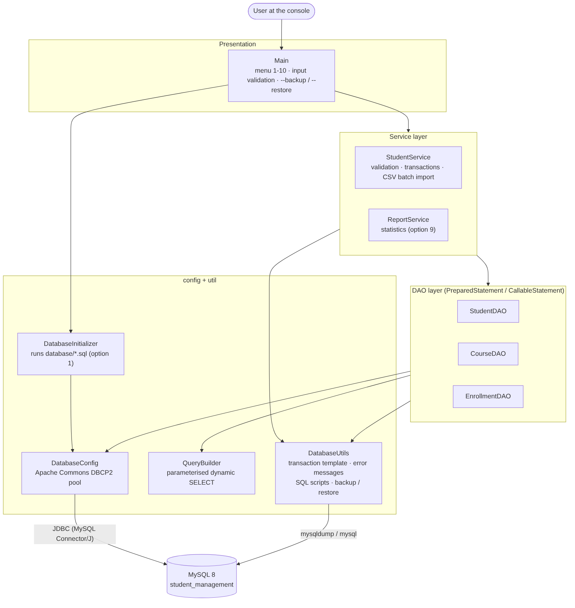
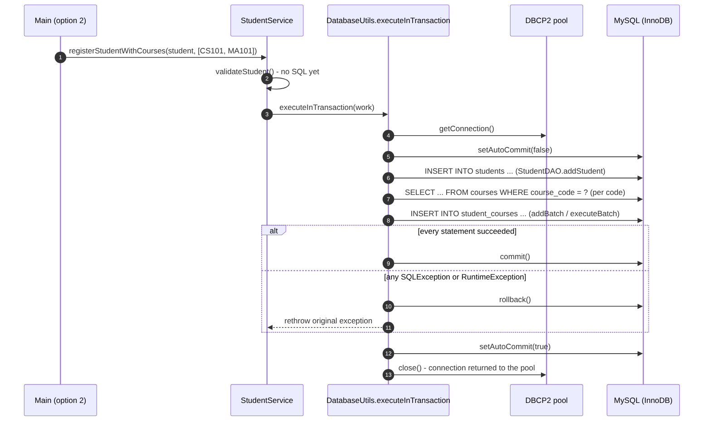

# JDBC and DAO Architecture

## 1. Layers



| Layer | Classes | Responsibility | Never does |
|---|---|---|---|
| Presentation | `Main` | console menu 1-10, reading and re-asking input, printing results, `--backup` / `--restore` | SQL |
| Service | `StudentService`, `ReportService` | validation, business rules, **transaction boundaries**, CSV parsing, reports | console I/O |
| DAO | `StudentDAO`, `CourseDAO`, `EnrollmentDAO` | one class per table: CRUD with `PreparedStatement`, stored-procedure calls with `CallableStatement`, row mapping | validation, console I/O |
| Model | `Student`, `Course`, `Enrollment` | plain Java objects (private fields, constructors, getters/setters, `toString`) | any logic |
| Config | `DatabaseConfig`, `DatabaseInitializer` | configuration + connection pool; creating database objects from the SQL scripts | business logic |
| Util | `DatabaseUtils`, `QueryBuilder` | reusable JDBC helpers (transaction template, error messages, script runner, backup/restore), safe dynamic SELECT | |

Dependencies point downwards only. DAOs receive a `javax.sql.DataSource` in their constructor
(plain constructor injection, no framework), which is how the tests run the same code against
the test database.

---

## 2. Connection pooling (Apache Commons DBCP2)

`DatabaseConfig` creates one `BasicDataSource` for the whole application:

```java
BasicDataSource pool = new BasicDataSource();
pool.setDriverClassName("com.mysql.cj.jdbc.Driver");
pool.setUrl(getUrl());                     // db.url
pool.setUsername(getUsername());           // DB_USERNAME env var or db.username
pool.setPassword(getPassword());           // DB_PASSWORD env var or db.password
pool.setInitialSize(5);                    // pool.initialSize
pool.setMinIdle(5);                        // pool.minIdle
pool.setMaxIdle(10);                       // pool.maxIdle
pool.setMaxTotal(20);                      // pool.maxTotal
pool.setMaxWait(Duration.ofMillis(10000)); // pool.maxWaitMillis
pool.setPoolPreparedStatements(true);
pool.setMaxOpenPreparedStatements(100);    // pool.maxOpenPreparedStatements
pool.setDurationBetweenEvictionRuns(Duration.ofMillis(30000)); // keeps minIdle filled
pool.setTestOnBorrow(true);                // validated before it is handed out
pool.setRollbackOnReturn(true);            // safety net for forgotten transactions
pool.setAutoCommitOnReturn(true);
```

(Values shown are the defaults from `config/database.properties`; every one is configurable.)

* **Borrow / return.** `dataSource.getConnection()` borrows; `connection.close()` returns the
  connection to the pool - the physical MySQL session stays open and is reused.
  `DatabaseConfigTest.thePhysicalMySqlSessionIsReusedAfterClose` proves this with
  `SELECT CONNECTION_ID()`.
* **No leaks.** Every test in `StudentDAOTest`, `CourseDAOTest`, `EnrollmentDAOTest` and
  `StudentServiceTest` ends with an assertion that the number of active (borrowed) connections is
  back to 0; `MainMenuTest` checks the same after a complete menu session.
* **minIdle** is only maintained while DBCP2's evictor thread runs, which is why
  `timeBetweenEvictionRunsMillis` is set.
* **Lazy start.** Creating the pool does not connect. If the database does not exist yet,
  the first `getConnection()` fails with MySQL error 1049 and the user is told to run option 1;
  after option 1 the same pool connects normally.
* **Shutdown.** `Main` calls `DatabaseConfig.closePool()` in a `finally` block on exit.
* **Database creation** is the only place that bypasses the pool: `DatabaseInitializer` opens one
  short-lived `DriverManager` connection to the server (without a default database) to run
  `CREATE DATABASE IF NOT EXISTS`, because pooled connections point at the database itself.

---

## 3. DAO design

### 3.1 Resource handling pattern

Every DAO method uses try-with-resources for `Connection`, `PreparedStatement` /
`CallableStatement` and `ResultSet`, so all three are closed (and the connection returned to the
pool) even when an exception is thrown:

```java
public Optional<Student> getStudentById(int id) throws SQLException {
    try (Connection connection = dataSource.getConnection();
         PreparedStatement statement = connection.prepareStatement(SELECT_BY_ID_SQL)) {
        statement.setInt(1, id);
        try (ResultSet rs = statement.executeQuery()) {
            return rs.next() ? Optional.of(mapRow(rs)) : Optional.empty();
        }
    }
}
```

DAO methods declare `throws SQLException`; they never swallow errors. Operations that must take
part in a caller's transaction have an overload that receives the `Connection`
(e.g. `StudentDAO.addStudent(Connection, Student)`, `CourseDAO.getCourseByCode(Connection, String)`,
`EnrollmentDAO.addEnrollmentsBatch(Connection, List)`); they neither commit nor close it.

### 3.2 Operations per DAO

**StudentDAO** (`students`)

| Method | SQL | Notes |
|---|---|---|
| `addStudent(Student)` / `addStudent(Connection, Student)` | `INSERT ... VALUES (?, ?, ?, ?, ?, ?, ?)` | `RETURN_GENERATED_KEYS`, id written back to the object |
| `getStudentById(int)` | `SELECT ... WHERE id = ?` | returns `Optional` |
| `getAllStudents()` | `SELECT ... ORDER BY id` | |
| `searchStudents(keyword, department, minGpa)` | built by `QueryBuilder` | any combination of criteria, all values bound as parameters |
| `updateStudent(Student)` | `UPDATE ... WHERE id = ?` | returns false if the id does not exist |
| `deleteStudent(int)` | `DELETE ... WHERE id = ?` | enrollments removed by `ON DELETE CASCADE` |
| `addStudentsBatch(List)` | `addBatch()` / `executeBatch()` | one transaction, chunks of 500, ids written back |
| `getStudentsByDepartment(String)` | `{CALL GetStudentsByDepartment(?)}` | `CallableStatement` |
| `getAllDepartments()` | `SELECT DISTINCT department ...` | hint list for option 8 |

**CourseDAO** (`courses`): `addCourse`, `getCourseById`, `getCourseByCode` (+ connection overload),
`getAllCourses`, `updateCourse`, `deleteCourse`.

**EnrollmentDAO** (`student_courses`): `addEnrollment`, `addEnrollmentsBatch(Connection, List)`,
`getEnrollment(studentId, courseId)`, `getEnrollmentsByStudent`, `getEnrollmentsByCourse`,
`getAllEnrollments`, `updateEnrollment`, `deleteEnrollment`.

The menu defined by the specification is student-centred, so it uses the course and enrollment
DAOs for course lookups, enrollment on registration, batch enrollment and the student detail
view. Their complete CRUD API is exercised by `CourseDAOTest` and `EnrollmentDAOTest`.

### 3.3 Type mapping

| MySQL | Java | JDBC call |
|---|---|---|
| INT / TINYINT | `int` | `setInt` / `getInt` |
| VARCHAR | `String` | `setString` / `getString` |
| DECIMAL(3,2) | `BigDecimal` (nullable) | `setBigDecimal` or `setNull(Types.DECIMAL)` / `getBigDecimal` |
| DATE | `LocalDate` | `setObject(LocalDate)` / `getObject(col, LocalDate.class)` (JDBC 4.2) |
| TIMESTAMP | `LocalDateTime` | `getObject(col, LocalDateTime.class)` |

---

## 4. SQL-injection protection

* All values from users go through `PreparedStatement.setXxx(...)`; no statement concatenates
  user input. Example from `StudentDAO`:

  ```java
  private static final String SELECT_BY_ID_SQL = "SELECT " + COLUMN_LIST + " FROM students WHERE id = ?";
  ...
  statement.setInt(1, id);
  ```

* The only dynamic SQL, the search, is built by `QueryBuilder`, which
  * accepts only plain identifiers (`[A-Za-z_][A-Za-z0-9_]*`) for table/column names,
  * accepts conditions written in the code with `?` placeholders and checks that the number
    of placeholders equals the number of values,
  * escapes `%`, `_` and `\` in search text so they match literally (`containsPattern`).
* Tests: `StudentDAOTest.searchTreatsWildcardsAndSqlInjectionAttemptsAsPlainText`
  (`' OR '1'='1`, `x'; DROP TABLE students; --`, `%`, `_` all return no rows and the table is
  untouched) and the `QueryBuilderTest` class.
* Plain `Statement` is used only for trusted text: the project's own `.sql` files (executed by
  `DatabaseUtils.executeStatements`) and `CREATE DATABASE` with the name from `db.url`, which
  `DatabaseConfig` restricts to `[A-Za-z0-9_]` (identifiers cannot be bound as parameters).

---

## 5. Transaction management

### 5.1 The transaction template

`DatabaseUtils.executeInTransaction` implements the pattern once, so every multi-statement
operation gets it right:

```java
public static <T> T executeInTransaction(DataSource dataSource, TransactionWork<T> work) throws SQLException {
    try (Connection connection = dataSource.getConnection()) {
        boolean originalAutoCommit = connection.getAutoCommit();
        connection.setAutoCommit(false);
        try {
            T result = work.execute(connection);
            connection.commit();
            return result;
        } catch (SQLException | RuntimeException e) {
            rollback(connection, e);        // a rollback failure is attached as suppressed exception
            throw e;
        } finally {
            restoreAutoCommit(connection, originalAutoCommit);
        }
    }                                       // close() returns the connection to the pool
}
```

### 5.2 Where transactions are used

| Operation | Statements in one transaction | Rolled back when |
|---|---|---|
| Add student **with courses** (option 2) - `StudentService.registerStudentWithCourses` | INSERT student, SELECT each course, batch INSERT enrollments | unknown course code, duplicate e-mail, any SQL error |
| CSV import (option 7.1) - `StudentDAO.addStudentsBatch` | all batched INSERTs (several `executeBatch()` chunks) | any row fails (e.g. duplicate e-mail) |
| Batch enrollment (option 7.2) - `StudentService.enrollStudentsInCourse` | SELECT course, batched INSERTs | unknown student id (FK), already enrolled (PK) |
| Sample data (option 1) - `DatabaseInitializer` | the three INSERT statements of `seed.sql` | any error |

### 5.3 Flow



### 5.4 Proof that rollback really happens

* `StudentServiceTest.registerWithCoursesRollsBackTheInsertedStudentWhenACourseIsUnknown` - the
  student INSERT has executed before the unknown course is detected; afterwards the table is
  empty, and the next student receives id 2 because InnoDB does not reuse the AUTO_INCREMENT
  value consumed by the rolled-back INSERT.
* `StudentDAOTest.batchIsRolledBackCompletelyWhenOneRowFails` - the failing row is in the
  second `executeBatch()` chunk, so 500 rows were already sent; none remain.
* `EnrollmentDAOTest.aFailingBatchRollsBackEverythingAlreadyDoneInTheTransaction` and
  `DatabaseUtilsTest.transactionIsRolledBackWhenAStatementFails / ...OnARuntimeException`.
* `DatabaseUtilsTest.autoCommitIsRestoredBeforeTheConnectionGoesBackToThePool`.

DDL in `schema.sql` / `procedures.sql` is not transactional in MySQL (implicit commit), which is
why those scripts are written to be re-runnable instead.

Isolation level: InnoDB default `REPEATABLE READ`.

---

## 6. Batch operations

```java
try (PreparedStatement statement = connection.prepareStatement(INSERT_SQL, Statement.RETURN_GENERATED_KEYS)) {
    for (Student student : students) {
        bindStudent(statement, student);
        statement.addBatch();
        if (++queued == BATCH_SIZE) {          // 500
            inserted += executeBatchAndAssignIds(statement, students, inserted);
            queued = 0;
        }
    }
    if (queued > 0) {
        inserted += executeBatchAndAssignIds(statement, students, inserted);
    }
}
```

* Runs inside `executeInTransaction` -> all rows or none.
* `rewriteBatchedStatements=true` in the JDBC URL lets Connector/J send each batch as multi-row
  INSERT statements. The driver then reports `Statement.SUCCESS_NO_INFO` (-2) per row, which the
  code treats as success; only `EXECUTE_FAILED` is an error.
* Generated keys of each chunk are written back to the `Student` objects.
* `EnrollmentDAO.addEnrollmentsBatch` refuses to run on an auto-commit connection
  (`IllegalStateException`), so it can only be used inside a transaction.
* Measured effect: see [PERFORMANCE.md](PERFORMANCE.md#4-batch-processing).

---

## 7. Stored procedures from Java

```java
// result set (StudentDAO)
try (Connection connection = dataSource.getConnection();
     CallableStatement statement = connection.prepareCall("{CALL GetStudentsByDepartment(?)}")) {
    statement.setString(1, department);
    try (ResultSet rs = statement.executeQuery()) { return mapRows(rs); }
}

// OUT parameters (ReportService)
try (Connection connection = dataSource.getConnection();
     CallableStatement statement = connection.prepareCall("{CALL GetDatabaseStatistics(?, ?, ?, ?)}")) {
    statement.registerOutParameter(1, Types.INTEGER);
    statement.registerOutParameter(2, Types.INTEGER);
    statement.registerOutParameter(3, Types.INTEGER);
    statement.registerOutParameter(4, Types.DECIMAL);
    statement.execute();
    int students = statement.getInt(1);
    ...
}
```

---

## 8. Error handling and logging

| Situation | What the user sees | What is logged |
|---|---|---|
| Invalid input while typing | the specific rule, question asked again (e.g. `'31/12/2004' is not a valid date - use the format yyyy-MM-dd`) | - |
| Validation in the service (`IllegalArgumentException`) | `Validation error: <all problems>` | - |
| `SQLException` | `ERROR: <friendly text> [MySQL: <message> \| SQLState <state>, error <code>]` | stack trace at WARNING in `logs/application.log` |
| File problems (CSV, backup) | `ERROR: <message>` | stack trace |
| Anything unexpected | `Unexpected error: ... (details in logs/application.log)` | SEVERE + stack trace |

`DatabaseUtils.describe` maps MySQL error codes to plain language: 1062 duplicate value,
1451 record still referenced, 1452 referenced record missing, 3819 CHECK constraint, 1406 value too
long, 1045 access denied, 1044/1142/1370 missing privilege, 1049 database missing, 1146 table
missing, 1305 procedure missing, SQLState `08xxx` connection failure. It unwraps the pool's
wrapper exceptions to find the driver's error. The menu keeps running after every error.

No `printStackTrace()` is used; logging goes through `java.util.logging` (JDK built-in). `Main`
sends log records to `logs/application.log` so the console only shows user messages.

---

## 9. Configuration

See the [README](../README.md#9-jdbc-configuration) for every property. Summary:

* `config/database.properties` - application; `config/database-test.properties` - tests
  (selected with `-Ddb.config=...`).
* `DB_USERNAME` / `DB_PASSWORD` environment variables override the file, so no password needs
  to be stored on disk.
* The database name, host and port are derived from `db.url` (validated with a regular
  expression).
